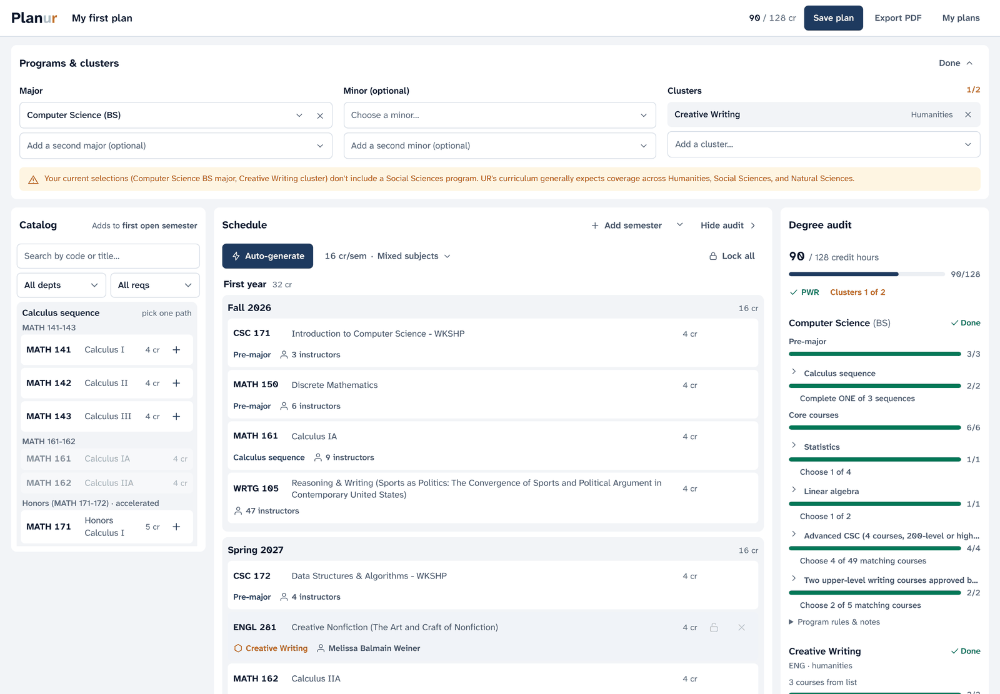

# Planur

A degree planner for University of Rochester undergraduates. Pick your majors,
minors and clusters, lay courses out across your semesters, and see a live audit
of every requirement as you go.

**Live demo:** https://nw12129312.github.io/PlanUR/



> Not an official degree audit. Requirements come from official UR pages and
> anything unverified is flagged in the app. Confirm your plan with your adviser.

## Features

- **182 majors and minors and 198 clusters**, each encoded from the department's
  own requirement page ([coverage](data-src/COVERAGE.md)).
- **Live degree audit** for prerequisites, offering terms, credit loads,
  double-counting limits, cluster rules, the Primary Writing Requirement and
  total credit hours. Every flag links to the policy it comes from.
- **Auto-generate** fills the open semesters for you while respecting the
  courses you've placed or locked, and lets you accept or reject each change.
- **Full course catalog** from the Registrar (fall, spring and summer), with
  instructors and RateMyProfessors ratings on each course.
- **AP/IB credit** mapped to the UR courses it counts as.
- **Alternate paths** such as the three calculus sequences, so a plan can't
  mix two of them.
- **Course status and GPA**: mark courses planned, in progress or completed,
  enter grades, and see your cumulative and major GPA checked against each
  program's minimum.
- **What-if audits** show how your plan would do for any other major or minor,
  instead of or alongside your current one, without changing it.
- **Closest to finishing** ranks the minors and clusters you're nearest to
  completing with the courses you already have.
- **Saved plans** that save automatically in your browser with no account,
  plus optional **Google sign-in** to keep them in sync across devices
  (set the `VITE_FIREBASE_*` values from `.env.example` to turn it on).
- **PDF export** to bring to your adviser.

## Run it locally

Requires Node 20 or newer.

```bash
npm install
npm run dev       # dev server at http://localhost:5173
npm test          # run the tests
npm run build     # single-file build in dist/index.html
```

Course and program data is generated from `data-src/` by `tools/build_data.py`.
See the [developer guide](docs/DEVELOPMENT.md) for the architecture, data
schema, how to add a program, and how auto-generate works.
